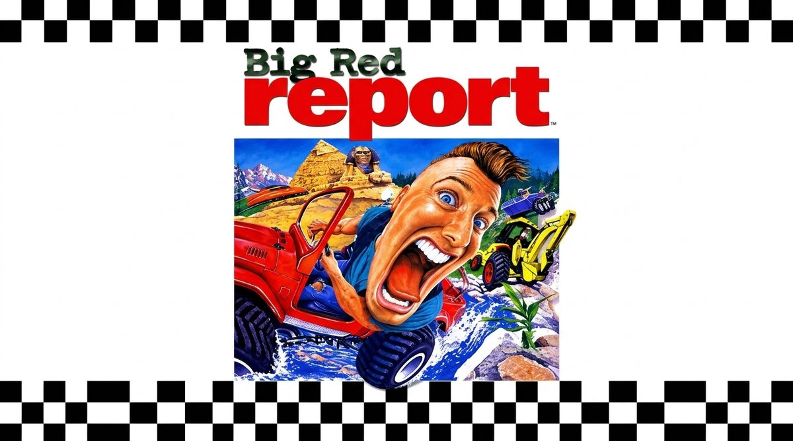

# Big Red Report

[English](README.md) · **Español** · [Français](README.fr.md) · [Italiano](README.it.md) · [Português](README.pt.md) · [Deutsch](README.de.md)

Port de fans de **Big Red Racing** (Big Red Software, 1995) para ordenadores modernos: el juego de carreras más loco de 1995, de jeeps a lanchas, helicópteros y buggies en Marte, con gráficos actuales, mandos de hoy, pantalla partida, red local (LAN), online y los rivales originales.

🌐 **Web:** https://bigredreport.github.io/bigredreport/

- ▶️ **Jugar en el navegador:** https://bigredreport.github.io/bigredreport/juego/BigRedRacing.html (se puede instalar como aplicación)
- 🪟 **Windows:** [BigRedReport-Windows.zip](https://github.com/BigRedReport/bigredreport/releases/latest/download/BigRedReport-Windows.zip) · 🐧 **Linux:** [BigRedReport-Linux.tar.gz](https://github.com/BigRedReport/bigredreport/releases/latest/download/BigRedReport-Linux.tar.gz)
- ⬇️ **Todas las descargas:** [última versión (Releases)](https://github.com/BigRedReport/bigredreport/releases/latest)
- 🗺️ **Hoja de ruta:** [ROADMAP.md](ROADMAP.md)
- 🐞 **Fallos:** pestaña *Issues* (plantilla «Reportar un fallo») o el formulario de la web
- 💬 **Comentarios:** [en la web](https://bigredreport.github.io/bigredreport/#comentarios)
- ❤️ **Apoyar el proyecto:** [Ko-fi](https://ko-fi.com/bigredreport) o el botón *Sponsor* de arriba

## Qué tiene

- **Juego original de 1995:** con F2 se arranca el RACING.EXE original en un emulador DOS integrado (DOSBox), con tu propia copia, filtros de imagen (nítido, suave o CRT) y mando.
- **Gráficos:** alta resolución, iluminación con sol y sombras (o la de 1995), suelo suavizado, humo y polvo, agua con olas, ultrapanorámicas y cualquier frecuencia.
- **Rivales:** las carreras grabadas del juego original o una IA nueva, en pelotón y con salidas limpias.
- **Multijugador:** pantalla partida hasta 8 y online sin servidor hasta 12, con reconexión, cambio de anfitrión, chat de texto y de voz.
- **Tu escudería:** cabeza y cuerpo del piloto, nombre de equipo, logos (también propios), color RGB y más de 35 bocinas.
- **Para todos:** controles a gusto, ayudas de conducción, colores para daltonismo, 6 idiomas y más de 60 logros.
- **Modos:** carrera rápida, campeonato, contrarreloj con salida lanzada, reto semanal, modo libre, **Grand Prix** y **Fórmula 1** en circuitos de estilo real, modo **drift** con tándems, kart con objetos, eliminación, bomba caliente, zombis y polis y cacos.
- **Creadores:** editor de circuitos (terreno, carretera, objetos, gradas, boxes, pianos automáticos) y circuitos de la comunidad que se publican, se votan y se descargan solos en el online.
- **Garaje:** llantas, neones, cristales, faros y color del turbo; coches nuevos como GT Racer, GT Sprint, Panda 86, Bávaro 30, Zeta 35, go-kart y un fórmula.
- **Plataformas:** navegador, Windows, Linux, Steam Deck y Android, con actualizaciones automáticas.
- **Extras:** cámaras de televisión, modo foto, contrareloj con clasificación online, modo libre con rampas y acrobacias, perfiles y mods.

## Cómo jugar

1. Necesitas tu **copia original** de Big Red Racing (la carpeta BIGRED; si está la imagen del CD, también suena su música).
2. Descarga el programa para Windows o Linux (descomprime y abre BigRedReport), o juega en la web (Chrome o Edge).
3. Pulsa **PRESS START** y elige la carpeta del juego. F2 para menu nuevo

## Código

Carpeta [juego/](juego/): JavaScript + WebGL2, sin dependencias. Servidor dedicado opcional en juego/server/ (Node.js).

---

El port lee los archivos de tu copia y **no incluye ni distribuye datos del juego**. Proyecto de fans gratuito, sin relación con Big Red Software, Domark ni los actuales dueños de los derechos. Las donaciones son para la web, los servidores y las herramientas; el juego es y será gratis.
