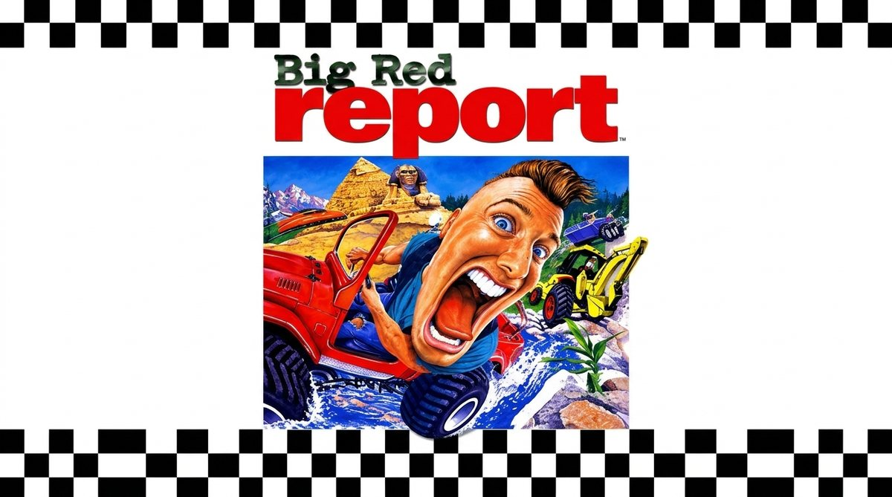

# Big Red Report

**English** · [Español](README.es.md)

A fan-made port of **Big Red Racing** (Big Red Software, 1995) for modern computers: the wildest racing game of 1995, from jeeps and speedboats to helicopters and Martian buggies, now with modern graphics, current controllers, split-screen, online multiplayer, and the original AI rivals.

🌐 **Website:** https://bigredreport.github.io/bigredreport/

- ▶️ **Play in your browser:** https://bigredreport.github.io/bigredreport/juego/BigRedRacing.html (installable as an app)
- 🪟 **Windows:** [BigRedReport-Windows.zip](https://github.com/BigRedReport/bigredreport/releases/latest/download/BigRedReport-Windows.zip) · 🐧 **Linux:** [BigRedReport-Linux.tar.gz](https://github.com/BigRedReport/bigredreport/releases/latest/download/BigRedReport-Linux.tar.gz)
- ⬇️ **All downloads:** [latest release](https://github.com/BigRedReport/bigredreport/releases/latest)
- 🗺️ **Roadmap:** [ROADMAP.md](ROADMAP.md)
- 🐞 **Bug reports:** the *Issues* tab (use the “Report a bug” template) or the form on the website
- 💬 **Comments:** [on the website](https://bigredreport.github.io/bigredreport/#comentarios)
- ❤️ **Support the project:** [Ko-fi](https://ko-fi.com/bigredreport) or the *Sponsor* button above

## Features

- **Graphics:** high resolution, modern lighting with sunlight and shadows (or the original 1995 look), smoother terrain, smoke and dust, wavy water, ultrawide support, and uncapped frame rates.
- **Rivals:** the original game's recorded races or a new AI, racing in packs with cleaner starts.
- **Multiplayer:** split-screen for up to 8 players and online play for up to 12, with reconnection, host migration, text chat, and voice chat.
- **Your team:** choose your driver's head and body, team name, logos (including custom ones), RGB colors, and more than 35 horns.
- **Accessibility and options:** customizable controls, driving assists, color-blind modes, 6 languages, and 21 achievements.
- **More:** TV cameras, photo mode, time trials with online leaderboards, stunt mode with ramps and tricks, profiles, and mods.

## How to play

1. You need your **own original copy** of Big Red Racing (the `BIGRED` folder; if you have the CD image, the game's music can also play).
2. Download the Windows or Linux app (extract it and open `BigRedReport`), or play on the web (Chrome or Edge).
3. Press **PRESS START** and select your original game folder. Press F2 for the new menu.

## Code

The [`juego/`](juego/) folder contains the game: JavaScript + WebGL2, with no dependencies. An optional dedicated server is in `juego/server/` (Node.js).

---

This port reads files from your own copy and **does not include or distribute the game's data**. This is a free fan project and is not affiliated with Big Red Software, Domark, or the current rights holders. Donations support the website, servers, and tools; the game will always be free.
